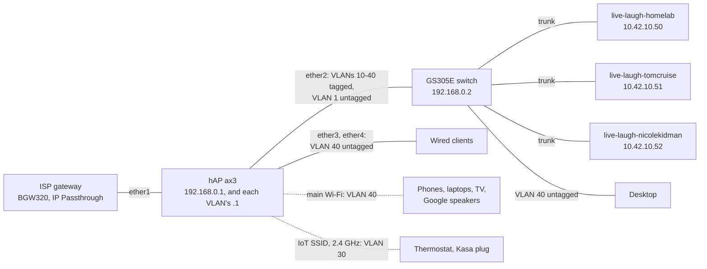

# homelab-infra

Infrastructure as code for my home lab: a three-node Proxmox cluster, the MikroTik router in front of it, and the Tailscale tailnet that reaches it from anywhere.

- **OpenTofu** creates the guests ([`stacks/homelab`](stacks/homelab/)), configures the router ([`stacks/network`](stacks/network/)), and owns the Tailscale keys, routes, split DNS and ACLs ([`stacks/tailnet`](stacks/tailnet/)).
- **Ansible** ([`ansible/`](ansible/)) configures everything inside the guests, and the Proxmox nodes themselves.
- **CI** deploys every merge to `main`, and `@claude` on an issue opens a PR.

The nodes are `live-laugh-homelab` (10.42.10.50), `live-laugh-tomcruise` (10.42.10.51) and `live-laugh-nicolekidman` (10.42.10.52). Any one of them can go down without the cluster losing quorum.

## Services

| Guest | ID | Address | Name | Notes |
|---|---|---|---|---|
| Pi-hole | 100 | 10.42.10.10 | https://pihole.home.arpa | LAN DNS; holds the `*.home.arpa` records |
| Home Assistant OS | 102 | 10.42.30.83:8123 | https://homeassistant.home.arpa | The only VM |
| Mosquitto | 104 | 10.42.30.20:1883 | — | MQTT broker |
| Caddy | 105 | 10.42.10.21 | — | HTTPS reverse proxy for every name |
| Gitea | 106 | 10.42.10.22:3000 | https://gitea.home.arpa | Source of truth for this repo, mirrored to GitHub |
| Jellyfin | 107 | 10.42.20.23:8096 | https://jellyfin.home.arpa | iGPU passthrough |
| Uptime Kuma | 108 | 10.42.10.24:3001 | https://uptime.home.arpa | Uptime checks and alerts |
| Metrics | 109 | 10.42.10.25:3000 | https://grafana.home.arpa | Grafana + InfluxDB, fed by Proxmox |
| Proxmox Backup Server | 110 | 10.42.10.26:8007 | https://pbs.home.arpa | Nightly backups |
| Proxmox Backup Server 2 | 115 | 10.42.10.32:8007 | https://pbs2.home.arpa | Second copy of every backup |
| Runner | 112 | 10.42.10.29 | — | Gitea Actions runner, no infra credentials |
| Deployer | 113 | 10.42.10.30 | — | Applies every new commit on `main` |
| Arr | 114 | 10.42.20.31 | https://sonarr.home.arpa, radarr, prowlarr, bazarr, qbit, sabnzbd, seerr | Docker Compose stack, torrents behind a VPN |
| LiveSync | 116 | 10.42.10.33:5984 | https://livesync.home.arpa | CouchDB for Obsidian's Self-hosted LiveSync |

Everything except Home Assistant is an unprivileged Debian 13 LXC built from [`modules/lxc`](modules/lxc/). The addresses and names work anywhere the LAN is reachable, including over Tailscale.

## How it fits together

### Names and HTTPS

Pi-hole points every `<name>.home.arpa` at Caddy, and Caddy proxies it to the right `ip:port`. Both come from `proxied_services` in [`ansible/group_vars/all.yml`](ansible/group_vars/all.yml), so adding a service there is all it takes to give it a name.

No public CA issues certificates for `home.arpa`, so Caddy runs its own CA and redirects `http://` to `https://`. To trust it, install the root certificate from http://10.42.10.21 once on each device.

### High availability

Pi-hole, Caddy, Home Assistant and Gitea are under Proxmox HA. Each has a `failover` node in `all.yml`. From that, [`stacks/homelab/ha.tf`](stacks/homelab/ha.tf) sets up ZFS replication to the failover node every 2–15 minutes, an HA resource and a node rule.

| Guest | Runs on | Fails over to |
|---|---|---|
| Pi-hole, Caddy | `live-laugh-homelab` | `live-laugh-tomcruise` |
| Home Assistant | `live-laugh-homelab` | `live-laugh-nicolekidman` |
| Gitea | `live-laugh-tomcruise` | `live-laugh-homelab` |

A failover takes a few minutes and loses whatever changed since the last sync. Before rebooting a node, put it in maintenance mode (`ha-manager crm-command node-maintenance enable <node>`) so its guests move away first.

### Network

The AT&T gateway passes the public IP straight through to a MikroTik hAP ax3, so there's no double NAT. The hAP does the routing, DHCP, firewall and Wi-Fi, all through its REST API from [`stacks/network`](stacks/network/). The nodes hang off a Netgear GS305E switch, so rebooting the router doesn't break the cluster.

### VLANs

| VLAN | Subnet | For | Reaches |
|---|---|---|---|
| 10 services | `10.42.10.0/24` | the nodes, Pi-hole, Caddy and the rest of the infrastructure | everything |
| 20 media | `10.42.20.0/24` | Jellyfin, arr | the internet, Pi-hole's DNS |
| 30 iot | `10.42.30.0/24` | Home Assistant, Mosquitto, smart-home gadgets (DHCP) | the internet, Pi-hole's DNS |
| 40 clients | `10.42.40.0/24` | Wi-Fi, desktops, laptops (DHCP) | everything |

The third octet is the VLAN ID. The router and switch keep their management addresses on the untagged VLAN 1 (`192.168.0.0/24`). The IoT gadgets get their own 2.4 GHz SSID, and mDNS is repeated across VLANs so phones can still cast to the speakers. Who reaches what is set in `vlan_policy` in [`stacks/network/vlans.tf`](stacks/network/vlans.tf) and in [`firewall.tf`](stacks/network/firewall.tf).

How it's wired:



Who can open connections to whom. Thick arrows reach everything on the other side, dotted ones only what they're labelled with. Replies always get back, so these are only about who starts a connection:


### Remote access

Every node runs Tailscale as a subnet router for the services and media VLANs (plus the management LAN), so remote access survives losing a node. A split-DNS rule sends `home.arpa` lookups to Pi-hole, so the names work remotely too. Nothing inside the guests runs Tailscale. The tailnet policy lives in [`stacks/tailnet/policy.hujson.tftpl`](stacks/tailnet/policy.hujson.tftpl).

### Media

Jellyfin and the arr stack are separate containers on `live-laugh-nicolekidman` that bind-mount one shared folder. It sits on three 2 TB HDDs pooled with mergerfs, with no redundancy on purpose. Downloads and the library are on the same pool, so Sonarr and Radarr hardlink instead of copying. qBittorrent only gets out through gluetun's WireGuard tunnel, and SABnzbd connects straight to its server over SSL.

### Backups

- Every guest is backed up nightly to `pbs` (7 daily, 4 weekly, 3 monthly).
- `pbs2`, on another node, pulls each new backup and keeps its own copy, so losing `pbs` or its disk loses nothing.
- Both are in the same house, so neither covers losing the house.

### CI

The infra credentials never touch code that hasn't been approved. That takes two containers:

- **runner** is the only Gitea Actions runner. It runs [`check`](.gitea/workflows/check.yml) (fmt, validate, ansible-lint) on PRs and [`claude`](.gitea/workflows/claude.yml) for `@claude` on issues. It holds no infra credentials.
- **deployer** isn't a runner, so no workflow can reach it. Every 2 minutes it fetches `main`, and for each new commit it runs `tofu apply` on `stacks/homelab`, then `ansible-playbook site.yml`.
- **`stacks/tailnet` and `stacks/network` are only ever applied by hand**, so a merge can't cut remote access or take the network down.

Gitea is the source of truth, and every branch mirrors to GitHub.

## Layout

```
modules/lxc/          reusable LXC container module
stacks/homelab/       the guests, and HA
stacks/tailnet/       Tailscale key, route approval, split DNS, ACLs
stacks/network/       the router: bridge, VLANs, DHCP, firewall, Wi-Fi
ansible/
  site.yml            runs everything
  playbooks/          one per host or service
  roles/
  group_vars/all.yml  guest IDs, IPs, nodes, VLANs, proxied services
  connection_plugins/ pct: runs commands in containers through their node, no SSH into guests
.gitea/workflows/     check (lint + validate) and claude
docs/                 gotchas
```

`guests` in [`ansible/group_vars/all.yml`](ansible/group_vars/all.yml) is the single source of truth for every guest's ID, IP, VLAN and node. Tofu reads the same file, so changing an address there updates both.

## Running it

### Prerequisites

You need OpenTofu, Ansible (`ansible-core` + `paramiko`), root SSH on the nodes, a Proxmox API token and a Tailscale OAuth client. Secrets come from a gitignored `.env`, loaded by direnv. The variable names are in [`roles/deployer/defaults/main.yml`](ansible/roles/deployer/defaults/main.yml), plus the `TAILSCALE_OAUTH_*`, `TF_VAR_router_*` and `TF_VAR_wifi_*` ones. Tofu state lives in a Cloudflare R2 bucket, encrypted with `TF_VAR_state_passphrase`.

### Commands

```sh
tofu -chdir=stacks/homelab apply      # likewise stacks/tailnet, stacks/network

cd ansible
ansible-galaxy collection install -r requirements.yml
ansible-playbook site.yml --check --diff
ansible-playbook site.yml             # or playbooks/<service>.yml
```

Gotchas are in [docs/gotchas.md](docs/gotchas.md).
