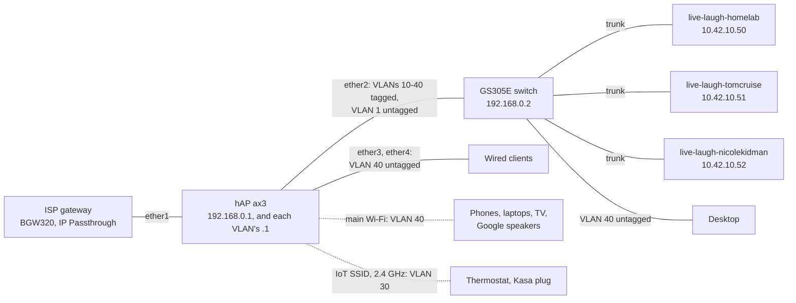
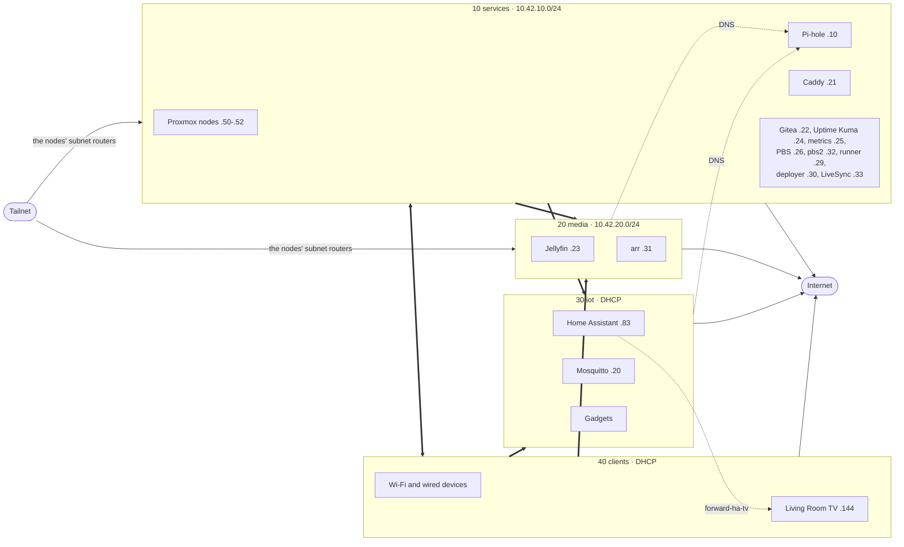

# homelab-infra

Infrastructure for my home Proxmox cluster of three nodes: `live-laugh-homelab` (10.42.10.50), `live-laugh-tomcruise` (10.42.10.51) and `live-laugh-nicolekidman` (10.42.10.52). Any one of them can be down without the cluster losing quorum.

- **OpenTofu** creates the guests (`stacks/homelab/`), owns the Tailscale key, route approval and split DNS (`stacks/tailnet/`), and configures the MikroTik router (`stacks/network/`).
- **Ansible** (`ansible/`) configures everything inside them, plus the Proxmox nodes themselves.

## Services

| Guest | ID | Direct address | Name | Notes |
|---|---|---|---|---|
| Pi-hole | 100 | http://10.42.10.10/admin | https://pihole.home.arpa | LAN DNS (port 53); holds the `*.home.arpa` records |
| Home Assistant OS | 102 | http://10.42.30.83:8123 (iot VLAN) | https://homeassistant.home.arpa | VM from community-scripts, imported into Tofu |
| Mosquitto | 104 | `mqtt://10.42.30.20:1883` (iot VLAN) | — | MQTT broker, no Ansible config yet |
| Caddy | 105 | http://10.42.10.21 | — | HTTPS reverse proxy for every `*.home.arpa` name; the direct address serves its root certificate (see [HTTPS](#https)) |
| Gitea | 106 | http://10.42.10.22:3000 | https://gitea.home.arpa | On `live-laugh-tomcruise`; first visit runs the web installer |
| Jellyfin | 107 | http://10.42.20.23:8096 (media VLAN) | https://jellyfin.home.arpa | On `live-laugh-nicolekidman`; iGPU passthrough; the media on its mergerfs pool (shared with arr), also over SMB at `\\10.42.20.23\media` |
| Uptime Kuma | 108 | http://10.42.10.24:3001 | https://uptime.home.arpa | Uptime checks and alerts; first visit creates the admin account |
| Metrics | 109 | http://10.42.10.25:3000 | https://grafana.home.arpa | Grafana (first login `admin`/`admin`) + InfluxDB on :8086, fed by Proxmox |
| Proxmox Backup Server | 110 | https://10.42.10.26:8007 | https://pbs.home.arpa | On `live-laugh-tomcruise`; datastore filling its 1 TB SSD. Log in as `admin@pbs` |
| Proxmox Backup Server 2 | 115 | https://10.42.10.32:8007 | https://pbs2.home.arpa | On `live-laugh-nicolekidman`; a second copy of every backup, on its 1 TB HDD (see [Backups](#backups)) |
| Runner | 112 | 10.42.10.29 | — | Gitea Actions runner for Claude and lint jobs; no infra credentials (see [CI](#ci)) |
| Deployer | 113 | 10.42.10.30 | — | Applies every new commit on `main` (see [CI](#ci)) |
| Arr | 114 | 10.42.20.31 (media VLAN) | https://sonarr.home.arpa, radarr, prowlarr, bazarr, qbit, sabnzbd, seerr | On `live-laugh-nicolekidman`; Docker Compose stack with two download clients, one behind a VPN (see [Media](#media)) |
| LiveSync | 116 | http://10.42.10.33:5984/_utils | https://livesync.home.arpa | On `live-laugh-tomcruise`; CouchDB for Obsidian's Self-hosted LiveSync plugin, no HA (see [Obsidian LiveSync](#obsidian-livesync)) |

The direct addresses and the `.home.arpa` names work anywhere the LAN is reachable, including over Tailscale.

Everything except Home Assistant is an unprivileged Debian 13 LXC built from [`modules/lxc`](modules/lxc/).

### How names resolve

Pi-hole points every `<name>.home.arpa` at Caddy (`10.42.10.21`), and Caddy proxies it to the right `ip:port`. Both are driven by `proxied_services` in [`ansible/group_vars/all.yml`](ansible/group_vars/all.yml), so adding a service there is all it takes to give it a name.

Note: the Pi-hole role overwrites the whole local DNS list, so records added in the Pi-hole web UI get replaced.

### HTTPS

Caddy serves every name over HTTPS and redirects `http://` to it. No public CA issues certificates for `home.arpa`, so Caddy runs its own CA and signs a certificate for each name. Browsers only trust them once Caddy's root certificate is installed, once per device:

- Download it from http://10.42.10.21 (any path gives you `root.crt`), on the LAN or over Tailscale.
- **Windows**: open it → Install Certificate → Local Machine → "Trusted Root Certification Authorities".
- **macOS**: open it in Keychain Access, then set it to "Always Trust".
- **iOS**: open the link in Safari and install the profile, then turn it on under Settings → General → About → Certificate Trust Settings.
- **Android**: Settings → Security → Encryption & credentials → Install a certificate → CA certificate.
- **Linux**: copy it to `/usr/local/share/ca-certificates/caddy.crt` and run `update-ca-certificates`. Firefox has its own store: Settings → Certificates → Import.

The root lasts 10 years. Caddy keeps it in `/var/lib/caddy/.local/share/caddy/pki/authorities/local`, which HA replication and the nightly backups carry along. If the container is rebuilt from scratch rather than restored, Caddy creates a new root, and every device needs the new one.

### Pi-hole and Caddy

There's one of each. Pi-hole's upstreams and blocklists come from [`ansible/roles/pihole/defaults/main.yml`](ansible/roles/pihole/defaults/main.yml) and its local records from `proxied_services`; change blocklists there, not in the web UI, since the next run replaces them. Allowlists and anything else set in the UI are kept.

Every container, the tailnet's split DNS and the router's DHCP (set on the router) use `10.42.10.10`. Until 2026-11 there was a second Pi-hole and Caddy on another node, with keepalived moving a VIP between the Caddys; Proxmox HA replaced them (see below).

### High availability

Pi-hole, Caddy, Home Assistant and Gitea are under Proxmox HA. Each has a `failover` node next to its `node` in [`ansible/group_vars/all.yml`](ansible/group_vars/all.yml), and [`stacks/homelab/ha.tf`](stacks/homelab/ha.tf) turns that into three things:

- A replication job that copies its disks to the failover node: every 2 minutes for Gitea, 5 for Pi-hole and Home Assistant, 15 for Caddy, at up to 40 MB/s so the 1 Gb link stays free for the cluster.
- An HA resource, so if its node goes down HA restarts it on the failover node, and moves it back once the node returns.
- A strict node rule: its own node first, then the failover node, never the third node, which has no copy of its disks.

| Guest | Runs on | Fails over to |
|---|---|---|
| Pi-hole, Caddy | `live-laugh-homelab` | `live-laugh-tomcruise` |
| Home Assistant | `live-laugh-homelab` | `live-laugh-nicolekidman` |
| Gitea | `live-laugh-tomcruise` | `live-laugh-homelab` |

Home Assistant fails over to `live-laugh-nicolekidman` because it's a VM, which HA moves live when it fails back or a node goes into maintenance, and a live move between `live-laugh-homelab`'s Intel CPU and `live-laugh-tomcruise`'s AMD one froze it for six minutes. Both other nodes are Intel. While it's running there, `live-laugh-nicolekidman` fences itself like the others if it loses the cluster.

What to expect:

- **A failover takes a few minutes, and loses what changed since the last sync.** HA waits about a minute to be sure the node is gone, then starts the guest from its last replicated copy. Pi-hole's query log or a push to Gitea in that window is gone.
- **Nodes running HA guests reboot themselves if they lose the cluster.** A node that can't reach the other two for about a minute assumes it's been cut off and restarts, so its guests can't run in two places. With every node on one switch, a long switch outage reboots `live-laugh-homelab` and `live-laugh-tomcruise`.
- **Before rebooting or shutting down a node on purpose**, run `ha-manager crm-command node-maintenance enable <node>`; HA moves its guests away first, live for Home Assistant. Run the same with `disable` afterwards, and they move back.
- **Stop or start an HA guest with `ha-manager set ct:<id> --state stopped`** (or `started`), not `pct stop` or the `<name>_running` local in its `.tf` file: HA restarts anything it's told should be running.
- When a guest moves, Proxmox points its replication job back at the other node by itself, so Tofu ignores the job's target after creating it, the same way it ignores a guest's node.
- **After a real failover, clean up on the home node once everything is back.** When a node dies, HA can't reverse the replication jobs, since the dead node can't be reached; so when the guests fail back, Proxmox copies their disks in full under new names (`subvol-100-disk-1` instead of `-disk-0`, and so on) and leaves the old volumes behind. Planned moves (maintenance mode, `pct migrate`, `qm migrate`) don't, since the job's target is reachable. To find and remove the leftovers, on the home node:

  ```sh
  # Volumes no guest's config mentions; each should be a guest's old disk
  for v in $(zfs list -H -o name -r rpool/data | tail -n +2 | sed 's|rpool/data/||'); do
    grep -rqs "local-zfs:$v\b" /etc/pve/nodes/*/lxc/ /etc/pve/nodes/*/qemu-server/ || echo "$v"
  done
  pvesm free local-zfs:<volume>    # for each one listed
  ```

  If Home Assistant's disks were renamed, update `path_in_datastore` in `stacks/homelab/homeassistant.tf` to match `qm config 102`.


### Remote access

Every Proxmox node runs Tailscale as a subnet router advertising the flat LAN `192.168.0.0/24` and the services and media VLANs (`tailnet_vlans` in [`all.yml`](ansible/group_vars/all.yml)), so the tailnet fails over if one node is down. iot and clients aren't reachable from the tailnet. Tofu mints an auth key per node and approves each route; Ansible installs Tailscale and joins the nodes. Nothing inside the containers runs Tailscale.

The tailnet policy (ACLs, tag owners, SSH rules) lives in [`stacks/tailnet/policy.hujson.tftpl`](stacks/tailnet/policy.hujson.tftpl). Edit it there, not in the admin console: the next `tofu apply` overwrites console changes.

Tofu also sets a split-DNS rule on the tailnet that sends `home.arpa` lookups to Pi-hole over that route, so the names work remotely too.

### Router

The ISP box is an AT&T BGW320-505 in IP Passthrough mode (it has no true bridge mode), so the public IP goes straight to a MikroTik hAP ax3 behind it, and there's no double NAT. The hAP (`live-laugh-router`, `192.168.0.1`) is the LAN's gateway, DHCP server and Wi-Fi. A Netgear GS305E switch hangs off it, and all three nodes plug into the switch, so rebooting the router (say, for a RouterOS update) doesn't break the cluster and make the HA nodes reboot themselves.

| hAP port | Use |
|---|---|
| ether1 | WAN, to the ISP box. It gets the public IP via [IP Passthrough](#setting-up-the-isp-gateway) |
| ether2–4, both radios | The LAN bridge, untagged VLAN 1. The switch goes on ether2, which also carries the [VLANs](#vlans) tagged |
| ether5 | Management only, `192.168.88.1/24`, outside the bridge. If an apply ever locks you out, plug a laptop in here with a static `192.168.88.2/24` |

[`stacks/network`](stacks/network/) configures it through the RouterOS REST API: the bridge and its VLANs, DHCP (Pi-hole for DNS, `.100`–`.254`, Home Assistant's address reserved), RouterOS's default firewall and NAT, one Wi-Fi network on both radios, and management services restricted to the LAN. IPv6 is off. Apply it by hand like `stacks/tailnet`; the deployer never does. To keep a DHCP device's address fixed, add it to `static_leases` in [`stacks/network/locals.tf`](stacks/network/locals.tf).

The GS305E has no API and runs no RouterOS, so its setup is manual (below). It carries the VLANs to the nodes tagged.

#### Setting up the router

Do this with the old router still in place. Nothing changes for the LAN until the final step.

1. **Update it.** Plug the hAP's ether1 into the old router and a laptop into ether2. The factory config gives the laptop an address and the hAP internet. Log in to WinBox or http://192.168.88.1 as `admin` with the password on the sticker. Then run `/system package update install`. Once it's back up, run `/system routerboard upgrade` and `/system reboot`.
2. **Wipe it.** Run `/system reset-configuration no-defaults=yes`. That leaves it with no address, so connect WinBox to it by MAC (the Neighbors tab), as `admin` with an **empty** password (not the sticker one). Change that password right away with `/password` and keep it in the password manager.
3. **Bootstrap it.** Paste [`stacks/network/bootstrap.rsc`](stacks/network/bootstrap.rsc) into WinBox's terminal. It puts `192.168.88.1/24` on ether5, makes a local CA and a certificate signed by it, and turns on the HTTPS API. Then add Tofu's user: `/user add name=tofu group=full password="<TF_VAR_router_password>"`.
4. **Stage it.** Unplug ether1, so it's no longer behind the old router. Plug the laptop into ether5 and give that adapter a static `192.168.88.2/24` with no gateway. The laptop keeps its internet over Wi-Fi, which Tofu needs for the state bucket. Under WSL, the address goes on the Windows adapter. Then run:

   ```sh
   export TF_VAR_router_url=https://192.168.88.1 TF_VAR_wifi_enabled=false
   cd stacks/network && tofu init && tofu plan && tofu apply
   ```

   The plan should import `wifi1` and `wifi2` and create everything else. Wi-Fi stays off here. Otherwise devices would join the hAP and its DHCP while it has no internet.
5. **Switch first.** Set up the GS305E (below) and plug it into the old router. Then move the nodes onto it **one at a time**. Before moving the next one, wait until `pvecm status` shows the moved node back and the cluster quorate. Done this way, the cluster never loses more than one node at once.
6. **Swap.** Move the ISP box's cable to the hAP's ether1 and the switch's uplink to ether2, then switch off the old router. If the hAP gets no address on ether1, power-cycle the ISP box: some only talk to the first MAC they saw. Then set up IP Passthrough (below). Set `TF_VAR_router_url=https://192.168.0.1` in `.env`, unset `TF_VAR_wifi_enabled`, and `tofu apply` again to turn on the Wi-Fi. It has the old SSID and passphrase, so devices rejoin by themselves. DHCP devices get new addresses from `.100` up, except those in `static_leases`.

The nodes, the guests and Tailscale don't notice the swap: the subnet, the gateway and Pi-hole stay the same.

#### Setting up the switch

The GS305E is configured in its web UI. Find it with Netgear's Switch Discovery Tool or in the old router's DHCP leases. It falls back to `192.168.0.239` if it gets no lease.

1. Log in with the default password, `password`, and change it.
2. Update its firmware (System → Maintenance → Firmware Upgrade).
3. Give it the static address `192.168.0.2/24` and gateway `192.168.0.1` (System → Management → Switch Information: DHCP Mode off). It has no DNS setting.

Leave VLANs alone for now: out of the box, every port is untagged on VLAN 1. Its web UI is plain HTTP, so only log in to it from the LAN.
4. Turn on the VLANs (VLAN → 802.1Q → Advanced → Enable). Add VLANs 10, 20, 30 and 40 under VLAN Configuration. Under VLAN Membership, make each of them **tagged** (T) on the uplink to the hAP and on the three node ports. Leave VLAN 1 untagged on every port and every PVID at 1, so the flat LAN, and the switch's own address on it, carry on as before.

#### Setting up the ISP gateway

The BGW320 belongs to AT&T and has only a web UI, so this is manual too. Without it, the hAP gets a private `192.168.1.x` address behind the gateway, which means double NAT, and port forwards (for WireGuard, say) would have to be set up on both.

1. Open http://192.168.1.254 → Firewall → IP Passthrough, and log in with the Device Access Code on the gateway's sticker.
2. Set Allocation Mode to **Passthrough** and Passthrough Mode to **DHCPS-fixed**. Set Passthrough Fixed MAC Address to the hAP's ether1 MAC (`/interface ethernet print` on the router, or the gateway's device list), then save.
3. Make the hAP ask for an address again with `tofu apply -replace=routeros_ip_dhcp_client.wan` in `stacks/network`. It should come back with the public IP on ether1, no longer `192.168.1.x`. ether1's address changes partway through, which kills tofu's connection to the state bucket, so the apply can sit at "Releasing state lock" for about 10 minutes before it retries and finishes. Don't Ctrl+C it.

#### VLANs

The hAP routes four VLANs, listed in `vlans` in [`ansible/group_vars/all.yml`](ansible/group_vars/all.yml), beside the flat LAN. That LAN is VLAN 1, untagged, and empties out as guests move off it. The third octet is the VLAN ID, and a guest keeps its last octet when it moves, so Jellyfin's `192.168.0.23` becomes `10.42.20.23`.

| VLAN | Subnet | For | Reaches |
|---|---|---|---|
| 10 services | `10.42.10.0/24` | the nodes, Pi-hole, Caddy and the rest of the infrastructure | everything |
| 20 media | `10.42.20.0/24` | Jellyfin, arr | the internet, Pi-hole's DNS |
| 30 iot | `10.42.30.0/24` | Home Assistant, Mosquitto, smart-home gadgets (DHCP) | the internet, Pi-hole's DNS |
| 40 clients | `10.42.40.0/24` | Wi-Fi, desktops, laptops (DHCP) | everything |

Each one's gateway is its `.1`. DHCP, on iot and clients, hands out `.100`–`.254` with Pi-hole for DNS. Replies always get back, so Caddy (or a client) can open Jellyfin's web UI, but nothing on media or iot can open a connection to the other VLANs or to the router, apart from DHCP. Services and clients can manage the router, like the flat LAN. To change who reaches what, edit `vlan_policy` in [`stacks/network/vlans.tf`](stacks/network/vlans.tf) and the rules in [`firewall.tf`](stacks/network/firewall.tf).

How it's wired. The router and switch keep their management addresses on VLAN 1; everything else is on a VLAN:



Who can open connections to whom. Thick arrows reach everything on the other side, dotted ones only what they're labelled with. Replies always get back, so these are only about who starts a connection:



Guests moved one group at a time: iot, media, clients, the services guests, then the nodes (steps below). A guest's `vlan` in `all.yml` puts it on one, with `ip` in that VLAN's subnet.

The IoT gadgets have their own SSID, `TF_VAR_wifi_iot_ssid`, on 2.4 GHz only, with its own WPA2 passphrase, so they never learn the main one. It's untagged into VLAN 30. The router repeats mDNS between the flat LAN, clients and iot, so phones still find the Google speakers to cast to. Pi-hole answers lookups from every VLAN (`pihole_listening_mode: ALL` in [`roles/pihole`](ansible/roles/pihole/defaults/main.yml)). Its default only answers its own subnet and silently drops the rest.

Setting them up, once:

1. **Router.** Run `tofu apply` in `stacks/network`. Turning on VLAN filtering resets the hAP's bridge, so the LAN drops out for a second or two. The nodes are on the switch, so the cluster doesn't notice. The router keeps `192.168.0.1` on untagged VLAN 1 throughout. If the reset cuts Tofu off mid-apply and it errors, run `tofu apply` again to finish.
2. **Switch.** Step 4 of setting up the switch, above.
3. **Nodes.** Run `ansible-playbook playbooks/proxmox-host.yml` (dry run first with `--check --diff`). Its last play, [`roles/node_network`](ansible/roles/node_network/), adds `bridge-vlan-aware yes` and `bridge-vids 2-4094` to `vmbr0` and runs `ifreload -a`. It does one node at a time, and only starts on a node once `pvecm status` shows all three nodes in a quorate cluster. Then it waits for that again before moving on. Untagged traffic, which is everything on VLAN 1 including the running guests, carries on as before. The rest of `/etc/network/interfaces` is still edited by hand.
4. **Check it.** On a node, put a throwaway address on VLAN 10 and ping the router through it. The node itself is only on VLAN 1, so first add VLAN 10 to the bridge's own port, and take it off again afterwards (guests get their VLANs on their own ports, so they don't need this):

   ```sh
   bridge vlan add dev vmbr0 vid 10 self
   ip link add link vmbr0 name vtest type vlan id 10
   ip addr add 10.42.10.250/24 dev vtest && ip link set vtest up
   ping -c3 10.42.10.1
   ip link del vtest
   bridge vlan del dev vmbr0 vid 10 self
   ```

Moving Home Assistant and the gadgets onto iot, once:

1. Add `TF_VAR_wifi_iot_ssid` and `TF_VAR_wifi_iot_passphrase` to `.env`, then `tofu apply` in `stacks/network`. That brings up the IoT SSID and moves Home Assistant's DHCP reservation to `10.42.30.83` on iot.
2. `tofu apply` in `stacks/homelab`, which tags Home Assistant's NIC and Mosquitto's into VLAN 30. Home Assistant keeps its old address until it asks DHCP again, so restart it: `qm reboot 102` on its node.
3. `ansible-playbook playbooks/caddy.yml`, which points `homeassistant.home.arpa` at the new address.
4. Move each gadget to the IoT SSID: the thermostat from its own menu, the Kasa plug in the Kasa app, the Google speakers in the Google Home app. Home Assistant finds them again on iot. If an integration was set up with an IP address, fix it there.

Moving Jellyfin and arr onto media, once:

1. `tofu apply` in `stacks/homelab`, which gives both containers their new address and VLAN tag.
2. `ansible-playbook playbooks/arr.yml`, which lists the subnets gluetun answers outside the tunnel (`arr_outbound_subnets`), then `ansible-playbook playbooks/caddy.yml`, which points the names at the new addresses.
3. In Seerr, change Jellyfin's address to `10.42.20.23` (Settings → Jellyfin). Not `jellyfin.home.arpa`: that goes through Caddy, which media can't reach.

Moving the main Wi-Fi and the wired clients onto clients, once. Every Wi-Fi device gets a new address, including whatever runs Tofu if it's on Wi-Fi, which would cut the apply off partway through. So run the router steps from a wired machine on hAP ether3, which stays on VLAN 1 until the last step:

1. `TF_VAR_wifi_enabled=false tofu apply` in `stacks/network`. The radios go off (the main Wi-Fi and IoT, briefly), the Wi-Fi ports go onto VLAN 40, and the reservations in `static_leases` move to clients, keeping their last octet.
2. `tofu apply` again. The radios come back, and every Wi-Fi device reconnects, asks DHCP and lands on `10.42.40.x`.
3. GS305E: for the wired desktop's port (the spare one), set VLAN 40 to **U** and VLAN 1 to blank, and that port's PVID to 40.
4. From any client: add `ether3` and `ether4` to `client_ports` in [`stacks/network/vlans.tf`](stacks/network/vlans.tf) and `tofu apply`.

Home Assistant still controls the TV, which is a client because it runs the Jellyfin app: `forward-ha-tv` in [`firewall.tf`](stacks/network/firewall.tf) lets Home Assistant, and nothing else on iot, through to the TV's reserved address.

Moving Pi-hole, Caddy and the rest of the services guests onto services, once. Every one gets a new address, so DNS and the `*.home.arpa` names are down from the first step until the third. Run it from a client, not the flat LAN. Step 2 needs DNS to reach the state bucket, but the machine running it still asks Pi-hole's old address, so first point that machine at a public resolver (in an admin PowerShell, `Set-DnsClientServerAddress -InterfaceAlias Wi-Fi -ServerAddresses 1.1.1.1`) and set it back to automatic (`-ResetServerAddresses`) after step 2:

1. `tofu apply` in `stacks/homelab`. Each guest gets its `10.42.10.x` address and VLAN tag, and every container's DNS points at Pi-hole's new one.
2. Straight after, `tofu apply` in `stacks/network`. DHCP hands out Pi-hole's new address, and the iot and media DNS rules follow it. Devices keep the old address from their lease for up to a day, so `old_pihole` in [`firewall.tf`](stacks/network/firewall.tf) sends their queries for `192.168.0.10` on to the new one. That doesn't cover the flat LAN, which reaches the old address without the router.
3. `ansible-playbook site.yml`. It points the Pi-hole records at Caddy's new address, the Proxmox storage at both PBS servers, pbs2's pull at pbs, the runner and deployer at Gitea, and the subnet routers at the new routes.
4. `tofu apply` in `stacks/tailnet`. It approves the new routes and sends tailnet `home.arpa` lookups to Pi-hole's new address.
5. By hand:
   - In Home Assistant's HTTP settings (in the UI since 2026.10, which ignores `configuration.yaml` for them), make the trusted proxy Caddy's new address, `10.42.10.21`. Until then, `homeassistant.home.arpa` gives a 400. Adding it next to `192.168.0.21` before step 1 avoids the gap.
   - On each node, `sed -i s/192.168.0.10/10.42.10.10/ /etc/resolv.pre-tailscale-backup.conf && systemctl restart tailscaled`. Tailscale's resolver falls back to that file for everything outside `home.arpa`; `tailscale dns status` lists it under System DNS configuration. The nodes are still on the flat LAN, so the redirect in step 2 doesn't reach them.
   - In every clone of this repo, `git remote set-url origin http://10.42.10.22:3000/noeltem/homelab-infra.git`.
   - In Uptime Kuma, fix any monitor that uses an IP address rather than a name.
6. A few days later, once every lease has renewed, delete `old_pihole` from `firewall.tf` and `tofu apply` in `stacks/network`.

Moving the nodes onto services, once. Their `/etc/network/interfaces` is edited by hand, not by Ansible: a bad run would cut a node off, and the deployer runs `site.yml` on every merge. Each node ends up with `vmbr0` as `inet manual` (still VLAN-aware, carrying the guests) and its address on `vmbr0.10`:

```
auto vmbr0.10
iface vmbr0.10 inet static
	address 10.42.10.50/24
	gateway 10.42.10.1
```

1. Disarm HA so a corosync hiccup can't fence a node: `ha-manager crm-command disarm-ha freeze`, and wait for `ha-manager status` to show every watchdog released.
2. On each node, add the `vmbr0.10` stanza above without the gateway and `ifreload -a`. Each node now answers on both addresses; check they ping each other and `10.42.10.1` on the new ones.
3. In `/etc/pve/corosync.conf`, change every `ring0_addr` to the new address and bump `config_version`. Once `/etc/corosync/corosync.conf` shows it on every node, `systemctl restart corosync` on each in turn. The first one is alone until the others restart, which is why HA is disarmed.
4. On each node, change its own line in `/etc/hosts`, `systemctl restart pve-cluster`, then `pvecm updatecerts --force && systemctl restart pveproxy` so the web UI's certificate has the new address.
5. One node at a time, make `vmbr0` `inet manual` (drop its address and gateway), add `gateway 10.42.10.1` to `vmbr0.10` and `ifreload -a`. Run it detached (`systemd-run --on-active=2 /sbin/ifreload -a`) and arm a rollback first (`systemd-run --unit=rollback --on-active=180 sh -c 'cp <dual-homed copy> /etc/network/interfaces && ifreload -a'`), then reconnect on the new address and check the default route, the internet, `tailscale status` and `pvecm status` before stopping the timer.
6. Change `PROXMOX_VE_ENDPOINT` in `.env` to `https://10.42.10.50:8006/` wherever Tofu runs, then `tofu plan` in `stacks/homelab` (no changes). `ansible-playbook playbooks/ci.yml` gives the deployer the new endpoint and known_hosts, and `tofu apply` in `stacks/tailnet` updates the node addresses in the ACL.
7. `ha-manager crm-command arm-ha` and check `pvesr status` on each node.

## Layout

```
modules/lxc/        reusable LXC container module
stacks/homelab/     the actual guests
stacks/tailnet/     Tailscale key, route approval + split DNS (kept apart so guest changes can't touch remote access)
stacks/network/     the hAP ax3 router: LAN, DHCP, firewall, Wi-Fi (kept apart so guest changes can't touch the network)
ansible/
  site.yml          runs everything
  connection_plugins/  pct: the faster container connection
  playbooks/        one per host/service
  roles/            caddy, gitea, jellyfin, media_share, media_mount, gpu_passthrough, tun_passthrough, arr,
                    pihole, pihole_dns, subnet_router,
                    uptime_kuma, influxdb, grafana, metrics_server, auto_updates, disk_storage, pbs, pbs_storage,
                    opentofu, ansible_tools, gitea_runner, claude_code, deployer
  group_vars/       shared vars (guest IDs/IPs, domain, proxied services)
.gitea/workflows/   CI: check (lint + validate on PRs) and claude (@claude on issues)
```

Guest IDs, IPs and nodes live only in `guests` in [`ansible/group_vars/all.yml`](ansible/group_vars/all.yml), and the cluster nodes in `nodes` next to it. Tofu reads that same file, so changing an address there updates both.

A guest's `node` there is where Tofu creates it. Moving a guest afterwards (by hand, or by HA) needs no change: Tofu ignores the node of an existing guest, and every playbook that configures containers starts with [`playbooks/locate-guests.yml`](ansible/playbooks/locate-guests.yml), which asks the cluster where each one is running and connects through that node.

To switch Jellyfin or arr off, set `running: false` on it there: Tofu stops it and keeps it from starting on boot, and Ansible skips it, since a stopped container can't be configured. The other guests still use the `<name>_running` local in their `.tf` file, which only Tofu reads.

## Prerequisites

- OpenTofu and Ansible (`ansible-core` + `paramiko`, e.g. via pipx)
- Optional: [pre-commit](https://pre-commit.com) (`pre-commit install`) to run `tofu fmt`, `tofu validate` and `ansible-lint` on commit
- An SSH key at `~/.ssh/id_ed25519` that can log in as root on every Proxmox node
- A Proxmox API token
- A Tailscale OAuth client with scopes `auth_keys` (tag `tag:homelab`), `devices:core:read`, `devices:routes`, `dns` and `policy_file`

Secrets live in a gitignored `.env` at the repo root (loaded by direnv via `.envrc`):

```sh
export PROXMOX_VE_ENDPOINT=https://10.42.10.50:8006/
export PROXMOX_VE_API_TOKEN=user@realm!token=secret
export TF_VAR_state_passphrase=...           # encrypts Tofu state and plans
export TAILSCALE_OAUTH_CLIENT_ID=...
export TAILSCALE_OAUTH_CLIENT_SECRET=...
export TF_VAR_r2_account_id=...             # Cloudflare account ID
export TF_VAR_r2_bucket=...                 # R2 bucket holding the state
export AWS_ACCESS_KEY_ID=...                # R2 API token (Object Read & Write on that bucket)
export AWS_SECRET_ACCESS_KEY=...
export TF_VAR_router_url=https://192.168.0.1   # https://192.168.88.1 while the hAP is staged (see Router)
export TF_VAR_router_password=...          # the router's tofu user
export TF_VAR_wifi_ssid=...
export TF_VAR_wifi_passphrase=...
export TF_VAR_wifi_country=...             # RouterOS's name for it, e.g. "United States"
export TF_VAR_wifi_iot_ssid=...            # the IoT gadgets' network (README: VLANs)
export TF_VAR_wifi_iot_passphrase=...
export INFLUXDB_TOKEN=...                   # e.g. openssl rand -hex 32; Grafana and Proxmox use it on every run
export INFLUXDB_PASSWORD=...                # InfluxDB admin; only read when InfluxDB is first set up
export PBS_ADMIN_PASSWORD=...               # admin@pbs on PBS; only read when that user is created
export PIHOLE_PASSWORD=...                  # Pi-hole web UI; only read when Ansible installs a new Pi-hole
export DEPLOYER_GITEA_TOKEN=...             # the deployer bot's Gitea token (see CI)
export SURFSHARK_WIREGUARD_PRIVATE_KEY=...  # VPN WireGuard private key (see Media); only read when arr is first set up
export SURFSHARK_WIREGUARD_ADDRESS=...      # the Address line of the VPN's WireGuard config, e.g. 10.14.0.2/16
export LIVESYNC_COUCHDB_PASSWORD=...        # CouchDB admin for Obsidian LiveSync; only read when livesync is first set up
```

`playbooks/ci.yml` copies all of these except the Tailscale ones to the deployer. It stops if any is unset, except the ones that are only read on first setup (`INFLUXDB_PASSWORD`, `PBS_ADMIN_PASSWORD`, `PIHOLE_PASSWORD`, the two `SURFSHARK_` ones and `LIVESYNC_COUCHDB_PASSWORD`), which it copies only if set.

## Usage

### Create / change guests

```sh
cd stacks/homelab
tofu init
tofu plan
tofu apply
```

The Tailscale side is the same in `stacks/tailnet`; it only needs the Tailscale and R2 credentials. The router is `stacks/network` (see [Router](#router)), which needs the router and R2 credentials.

On a fresh build (or a new node) the node isn't on the tailnet yet, so it takes two applies: `tofu apply` (mints the auth key), then `ansible-playbook playbooks/proxmox-host.yml` within the hour (joins the node), then `tofu apply` again (approves the route).

State lives in the R2 bucket at `homelab/terraform.tfstate`, `tailnet/terraform.tfstate` and `network/terraform.tfstate`, each encrypted with `TF_VAR_state_passphrase` before upload. Keep the passphrase in a password manager too: without it the state can't be read.

### Configure them

```sh
cd ansible
ansible-galaxy collection install -r requirements.yml

# dry run first
ansible-playbook site.yml --check --diff
ansible-playbook site.yml

# or just one service
ansible-playbook playbooks/jellyfin.yml
```

Ansible never SSHes into containers. It connects as root to the node each container is on and runs commands inside with `lxc-attach`, so containers don't need sshd or keys. The connection is [`connection_plugins/pct.py`](ansible/connection_plugins/pct.py): `community.proxmox.proxmox_pct_remote` with pipelining, and `lxc-attach` instead of `pct exec` (the same thing behind a slow Perl wrapper). Without those, every task took about 6 seconds. It overrides a private method of that collection, so check it still works after upgrading `community.proxmox`. `site.yml` bootstraps Python in each container before anything else.

The first Jellyfin run creates the SMB account and needs a password in the environment:

```sh
MEDIA_SHARE_PASSWORD=... ansible-playbook playbooks/jellyfin.yml
```

After that, change it with `smbpasswd media` inside the container. The share is `\\10.42.20.23\media`.

### Media

Jellyfin and the arr stack are separate containers on `media_node` (`live-laugh-nicolekidman`) that share one folder. Its three 2 TB HDDs are pooled into one 5.4 TB filesystem at `/mnt/pool` with [mergerfs](https://trapexit.github.io/mergerfs/), and `/mnt/pool/media` is bind-mounted into both at `/mnt/media` ([`roles/media_mount`](ansible/roles/media_mount/)). Downloads and the library are on the same filesystem, so Sonarr and Radarr import with hardlinks instead of copies:

```
/mnt/media/downloads/{tv,movies,anime}              qBittorrent saves here, one category each
/mnt/media/downloads/usenet/{incomplete,complete}   SABnzbd works here, complete/<category> when done
/mnt/media/{shows,movies,anime}                     Sonarr/Radarr hardlink here; Jellyfin's libraries
```

The media has no redundancy, on purpose. Each disk is plain ext4, and mergerfs spreads new files across them by free space (`category.create=pfrd`) and keeps a hardlink on the same disk as its file. Losing a disk loses only the files on it, which Sonarr and Radarr then show as missing.

Everything is owned by the `library` group (gid 2000, set in `group_vars/all.yml`), which exists in both containers with Jellyfin in it. The apps run as `arr` (uid 2000) with umask 002, so neither side locks the other out.

The arr container runs [Docker Compose](ansible/roles/arr/templates/compose.yaml.j2) in `/opt/arr`, with each app's config in `/var/lib/arr/<app>` (backed up by PBS). Inside the stack, apps reach each other by service name: in Sonarr and Radarr, add qBittorrent as host `gluetun`, port `8080`, and use `/data/...` paths (qBittorrent, SABnzbd, Sonarr, Radarr and Bazarr all see the media at `/data`). Point Prowlarr at `http://sonarr:8989` and `http://radarr:7878`, and Seerr at Jellyfin on `http://10.42.20.23:8096`. For indexers behind Cloudflare, add FlareSolverr in Prowlarr under Settings → Indexers → Indexer Proxies (host `http://flaresolverr:8191`, with a tag such as `flaresolverr`), then give those indexers the same tag. qBittorrent prints a temporary web UI password on first start: `docker compose -f /opt/arr/compose.yaml logs qbittorrent`.

SABnzbd is published on port 8085, but inside the stack it's `sabnzbd`, port `8080`. It doesn't go through the VPN; it connects straight to its server over SSL. To set it up:

- Run the first-run wizard at http://10.42.20.31:8085 and enter your server's host, port (usually `563` with SSL on), login, and connections up to your plan's limit.
- Under Config → Folders, set the temporary folder to `/data/downloads/usenet/incomplete` and the completed folder to `/data/downloads/usenet/complete`.
- Under Config → Categories, add `tv`, `movies` and `anime`.
- Under Config → Special, add `sabnzbd, sabnzbd.home.arpa` to `host_whitelist`, or it refuses Caddy and the other apps.
- In Sonarr and Radarr, add SABnzbd as a download client: host `sabnzbd`, port `8080`, the API key from Config → General, and the matching category.
- Add your indexers in Prowlarr with their API keys, and Prowlarr syncs them to Sonarr and Radarr.

qBittorrent uses gluetun's network, so its traffic only leaves through the VPN's WireGuard tunnel, and stops if the tunnel is down. The VPN doesn't forward ports, so nothing can connect in. To get the key, generate a WireGuard key pair in your VPN provider's manual-setup page and download a config for any location. The private key goes in `.env` as `SURFSHARK_WIREGUARD_PRIVATE_KEY` and the config's `Address` as `SURFSHARK_WIREGUARD_ADDRESS`. The first `playbooks/arr.yml` run writes them to `/opt/arr/vpn.env`; after that, edit that file and rerun the playbook. The server country is `arr_vpn_countries` in [`roles/arr/defaults/main.yml`](ansible/roles/arr/defaults/main.yml).

Images use `latest` tags and aren't updated automatically. To update, run `docker compose pull && docker compose up -d` in `/opt/arr`.

The bind mounts and the arr container's `/dev/net/tun` are set by Ansible with `pct set`, because both need `root@pam` and Tofu uses an API token. The LXC module ignores `mount_point` changes for that reason.

#### Setting up the disks by hand

The disks and mergerfs on `live-laugh-nicolekidman` aren't managed by Ansible, so after reinstalling the node, redo this. Formatting erases the disks:

```sh
mkfs.ext4 -L disk0 /dev/disk/by-id/ata-ST2000DM001-1ER164_Z4Z0BAQY
mkfs.ext4 -L disk1 /dev/disk/by-id/ata-ST2000DL003-9VT166_5YD6NFH7
mkfs.ext4 -L disk2 /dev/disk/by-id/ata-ST2000DL003-9VT166_5YD6NFHC
mkdir -p /mnt/hdd/disk{0,1,2} /mnt/pool
apt install mergerfs
```

`/etc/fstab`:

```
LABEL=disk0 /mnt/hdd/disk0 ext4 defaults,noatime,nofail 0 2
LABEL=disk1 /mnt/hdd/disk1 ext4 defaults,noatime,nofail 0 2
LABEL=disk2 /mnt/hdd/disk2 ext4 defaults,noatime,nofail 0 2
/mnt/hdd/disk2/pool:/mnt/hdd/disk1/pool:/mnt/hdd/disk0/pool /mnt/pool fuse.mergerfs cache.files=off,category.create=pfrd,func.getattr=newest,dropcacheonclose=false,allow_other,minfreespace=50G,fsname=pool,x-systemd.after=/mnt/hdd/disk0,x-systemd.after=/mnt/hdd/disk1 0 0
```

Then `systemctl daemon-reload && mount -a`, and once the disks are mounted:

```sh
mkdir /mnt/hdd/disk{0,1,2}/pool
mkdir /mnt/pool/media && chown 100000:102000 /mnt/pool/media && chmod 2775 /mnt/pool/media
```

- Each branch is a `pool` folder on its disk, which only exists while that disk is mounted, so a missing disk is skipped instead of mergerfs writing to the SSD in its place.
- systemd reads the pool's first branch as a path, so the pool requires that disk to mount; the youngest disk (`disk2`) goes first, and the other two are only waited for (`x-systemd.after`). `nofail` lets the node boot with a disk missing.
- `100000:102000` is the containers' root and `library` group as the host sees them.
- The media folders (`media_dirs` in `group_vars/all.yml`) are made by Ansible on the node, not in the containers: on the pool, a container's root acts as its host user (100000), which can't change owners, so creating them from inside fails.

### Obsidian LiveSync

`playbooks/livesync.yml` runs CouchDB (`couchdb` image, tag in [`roles/livesync/defaults/main.yml`](ansible/roles/livesync/defaults/main.yml)) in Docker Compose, with the settings the [Self-hosted LiveSync](https://github.com/vrtmrz/obsidian-livesync) plugin needs: single node, valid user required, CORS for the Obsidian apps, and large documents allowed. The data is under `/var/lib/livesync` on the container's root disk.

First setup: put `LIVESYNC_COUCHDB_PASSWORD` in `.env`, `tofu apply` in `stacks/homelab`, then run `playbooks/livesync.yml`, `caddy.yml` and `pihole.yml`. The first run writes the admin login to `/opt/livesync/couchdb.env`, and CouchDB keeps a hashed copy in `/var/lib/livesync/local.d/docker.ini`. To change the password later, do it in CouchDB (Fauxton at http://10.42.10.33:5984/_utils → the user menu), not in `.env`.

In Obsidian, install Self-hosted LiveSync and run its setup wizard with:

- URI `https://livesync.home.arpa`, username `obsidian`, the password above
- A database name per vault, e.g. `notes`. The plugin creates it.
- End-to-end encryption on, with a passphrase you keep somewhere else. The database and its backups then only hold encrypted chunks.

Then copy the setup URI it offers to the other devices. Mobile apps only sync over HTTPS, so each phone needs Caddy's root certificate (see [HTTPS](#https)). Away from home it works over Tailscale, like the other `.home.arpa` names.

Backups: every synced device holds the whole vault. The nightly PBS job also covers the container, with pbs2's copy on top (see [Backups](#backups)). CouchDB only appends to its files, so a snapshot taken while it runs restores cleanly. Restoring a backup rolls back the whole database, so to recover one note, use the plugin's history or the file on another device instead.

### Monitoring

`playbooks/metrics.yml` installs InfluxDB and Grafana, then points Proxmox's metric server (Datacenter → Metric Server) at InfluxDB. Proxmox pushes host and guest stats into the `proxmox` bucket, which keeps 30 days. Grafana already has InfluxDB as its data source. For dashboards, import [Proxmox [Flux]](https://grafana.com/grafana/dashboards/15356) (ID `15356`) under Dashboards → New → Import.

Uptime Kuma's monitors and notifications are set up in its web UI. They aren't in this repo.

### Backups

`playbooks/pbs.yml` installs Proxmox Backup Server and connects the cluster to it as storage `pbs`. A nightly job (`nightly`, 02:00) backs up every guest in snapshot mode, keeping 7 daily, 4 weekly and 3 monthly backups. PBS verifies each new backup and runs garbage collection on Saturdays. Volumes marked `backup = false`, like PBS's own datastore, are skipped, and so are bind mounts like the media.

The datastore takes up all of the M75s's 1 TB SSD. `disk_storage` (in `playbooks/proxmox-host.yml`) turns it into LVM storage `ssd-lvm`, wiping the disk the first time it runs and never again once the `ssd` volume group exists. On a fresh build, run `proxmox-host.yml` before `tofu apply`, since PBS's volume needs that storage.

`pbs2`, on `live-laugh-nicolekidman`, holds a second copy ([`roles/pbs_sync`](ansible/roles/pbs_sync/)):

- At 05:00 it pulls every new backup from `pbs`, logging in as `sync@pbs`, which can only read there.
- It keeps what it pulled even after `pbs` prunes or loses it, and prunes on its own at 07:00, on the same 7 daily, 4 weekly and 3 monthly terms.
- On Sundays it re-reads any copy it hasn't checked in 30 days, and runs garbage collection on Saturdays.
- The cluster has it as storage `pbs2`, read-only, for restores. Nothing backs up to it directly, and a node can't delete from it.

If `pbs`, its SSD or `live-laugh-tomcruise` is lost, restore from `pbs2` instead: pick the backup under storage `pbs2` in the web UI. Its datastore takes up the node's 1 TB HDD, as LVM storage `hdd-backup`, set up by hand:

```sh
vgcreate backup /dev/disk/by-id/ata-WDC_WD10EZEX-60WN4A0_WD-WCC6Y6PUS3S8
pvesm add lvm hdd-backup --vgname backup --nodes live-laugh-nicolekidman --content rootdir,images
```

Both copies are in the same house, so they don't cover losing the house.

### CI

Merging to `main` deploys it, and `@claude` on an issue gets a PR. It's split across two containers so the infra credentials never meet code you haven't approved:

- **runner** is the only Gitea Actions runner (label `claude`). It runs [`check`](.gitea/workflows/check.yml) (fmt, validate, ansible-lint) on every PR and [`claude`](.gitea/workflows/claude.yml) when you write `@claude` in a new issue or an issue comment. Claude edits a `claude/issue-<n>` branch, and the workflow pushes it, opens a PR and replies on the issue. The runner only holds Claude's two secrets, no infra credentials.
- **deployer** isn't a runner, so no workflow can reach it. Every 2 minutes it fetches `main`, and for each new commit it runs `tofu apply` on `stacks/homelab`, then `ansible-playbook site.yml`. A plan that deletes or replaces anything isn't applied: the deploy fails and you apply it by hand. The result shows as a `deploy` status on the commit. Logs: `journalctl -u deployer` on the deployer. Each commit is tried once; to try it again, run `touch /var/lib/deployer/retry && systemctl start deployer`. On its first run, and whenever `last-attempted` is missing, it marks whatever's on `main` as deployed without applying anything.
- **`stacks/tailnet` and `stacks/network` are never auto-applied.** Apply them by hand as before, so a merge can't cut remote access or take the network down. The deployer doesn't have the Tailscale or router credentials at all.
- Before Claude's changes are committed, the workflow checks them for Claude's tokens and anything shaped like an Anthropic key. If it finds one it stops without pushing, because the branch would be on public GitHub seconds later.

Runner labels only route jobs. They don't restrict them, so any branch could send a job to any runner. That's why the infra credentials sit on a host that only ever runs `main`, and `main` only gets code through branch protection.

One-time setup in Gitea, before `playbooks/ci.yml`:

1. Create two bot users, `claude` and `deployer`, and add both to `homelab-infra` as **Write** collaborators.
2. Tokens: `deployer` gets `write:repository` (for commit statuses), which goes in `.env` as `DEPLOYER_GITEA_TOKEN`. `claude` gets `write:repository` + `write:issue`, which goes in the repo's Actions secrets as `CLAUDE_GITEA_TOKEN`.
3. Run `claude setup-token` and add the result to the repo's Actions secrets as `CLAUDE_CODE_OAUTH_TOKEN`.
4. Branch protection on `main`, which is the approval gate:
   - **Disable push** for everyone, you excluded, so every change reaches `main` through a PR.
   - **Merge whitelist: `noeltem` only.** Your merge is the approval. Leave required approvals at 0, since Gitea doesn't let you approve your own PRs, so a 1 would block them.
   - **Apply to administrators**, so the owner account can't bypass it either.
   - Optionally require the `Check` status, once it has run once.

   Then check it works: a push to `main` with the claude bot's token should be rejected. For an emergency fix that can't wait for a PR, apply it locally with `tofu`/`ansible-playbook`, then get it onto `main` through a PR. Otherwise the next deploy reverts it.

Then `tofu apply` in `stacks/homelab` (creates both containers) and `ansible-playbook playbooks/ci.yml`. That run registers the runner with Gitea and authorizes the deployer's SSH key on the nodes.

Both of Claude's secrets are readable by any workflow on any branch, which is fine since they're only Claude's. Anything committed still goes to the public GitHub mirror.

## Gotchas

- **Containers use Pi-hole for DNS** (`dns_servers = local.pihole_ips`) because the host's `resolv.conf` points at Tailscale's resolver, which containers can't reach.
- **Rejoining Tailscale**: the auth key is single-use and expires an hour after creation. Mint a fresh one with `tofu -chdir=stacks/tailnet apply -replace='tailscale_tailnet_key.subnet_router["<node>"]'`, then rerun Ansible.
- **Tofu ignores a guest's node, and a container's root disk storage, once they exist.** Both force a rebuild in the provider when they change, so a migrated or failed-over guest, or a container disk moved to other storage, would otherwise plan a destroy. Move guests with `pct migrate`/`qm migrate` or HA, and container disks with `pct move-volume`, not by editing the config. Home Assistant's disks aren't ignored: after `qm disk move`, update their `datastore_id` in `homeassistant.tf` and check the plan is clean.
- **GPU and tun passthrough and the media bind mounts are done by Ansible, not Tofu**: they need `root@pam`, and Tofu uses an API token. The module ignores `device_passthrough` and `mount_point` changes for the same reason.
- **Docker in an LXC** (the arr container) relies on nesting and has broken after Proxmox updates before, usually over AppArmor. If containers stop starting after an upgrade, check `journalctl -u docker` in the container first.
- **Changing the LXC template** won't rebuild existing containers; the module ignores template changes. Tofu downloads the template to every node (`proxmox_download_file.debian_13` in `locals.tf`), so bump its URL and checksum to change it.
- **Tailscale OAuth scope errors** show up as 404s, not 403s.
- **Home Assistant**'s guest agent reports internal interfaces with changing MACs, so `mac_addresses` is ignored.

